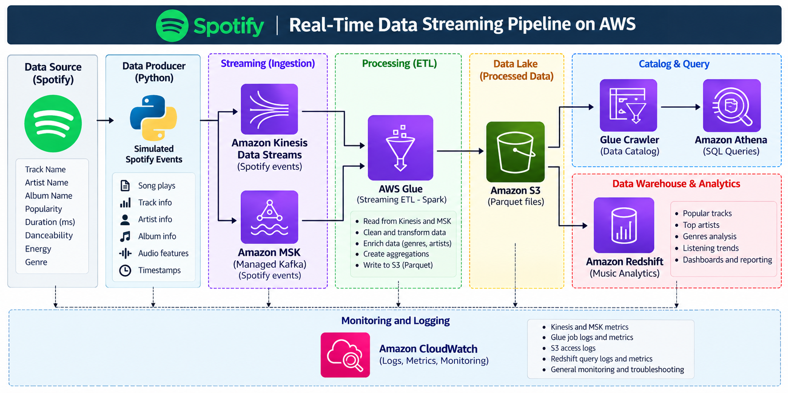
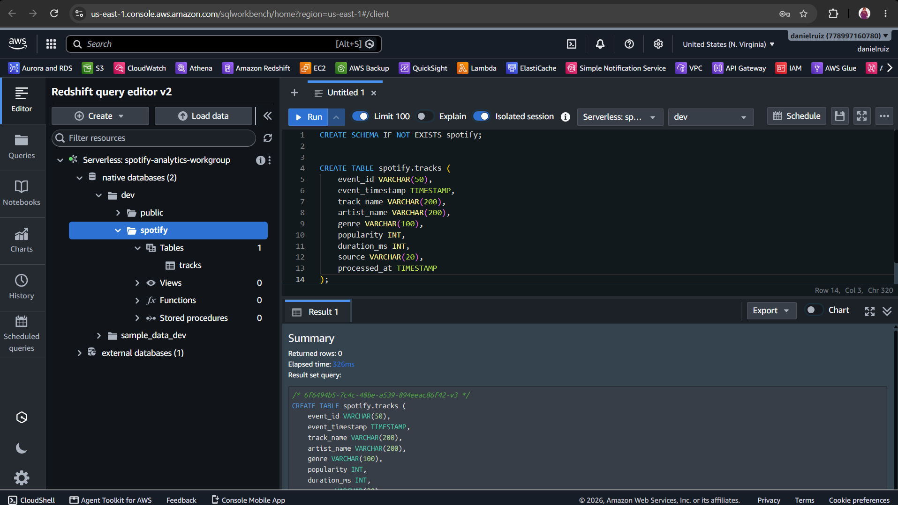
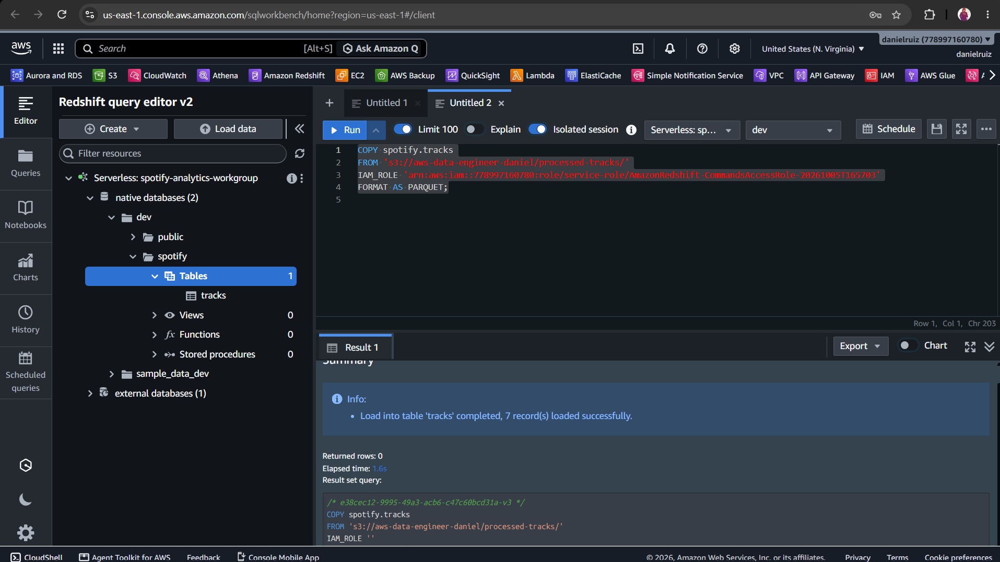
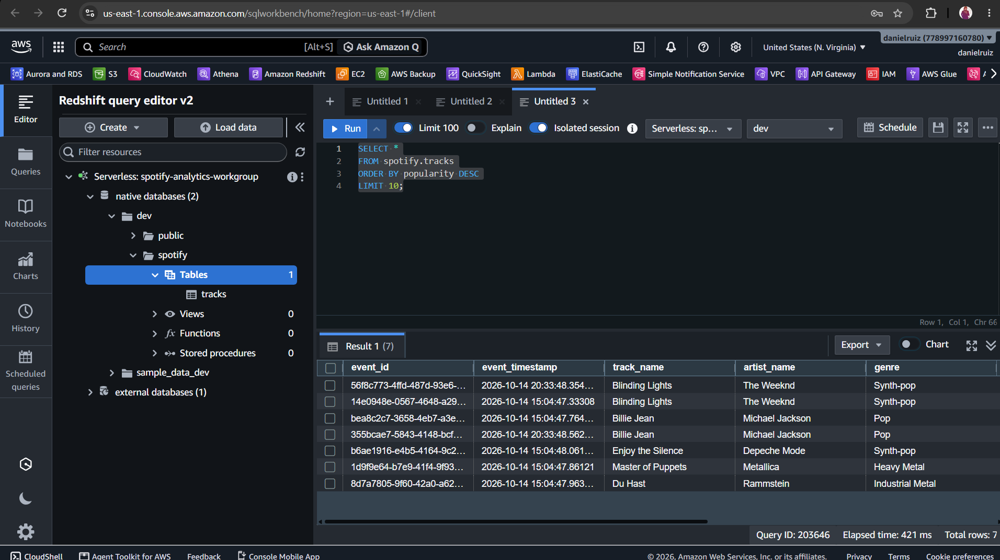
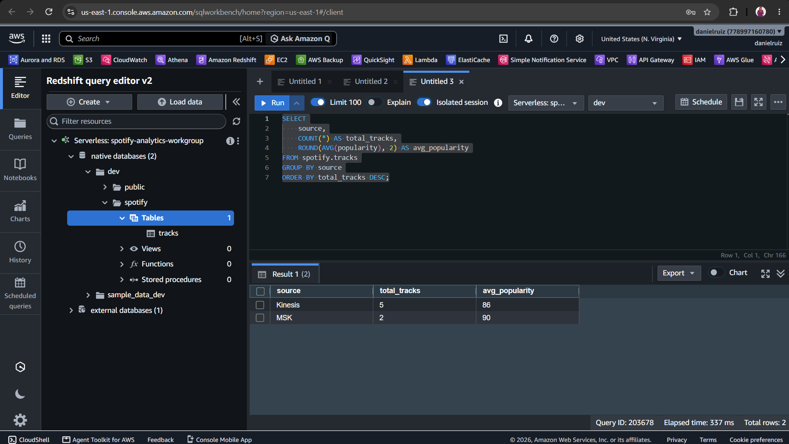
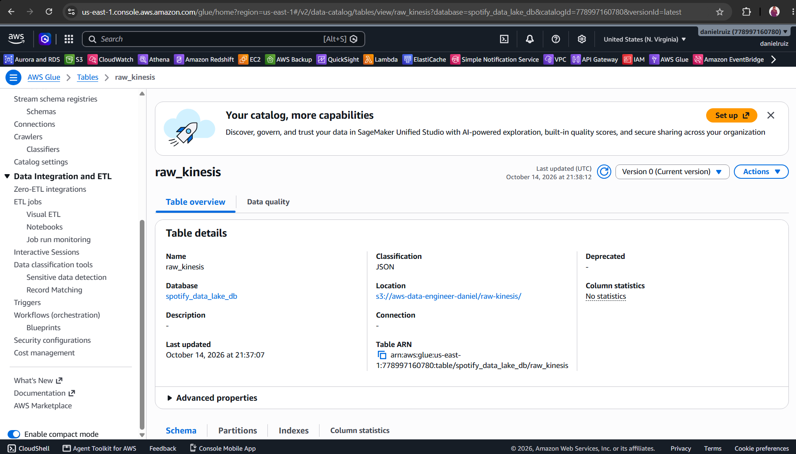
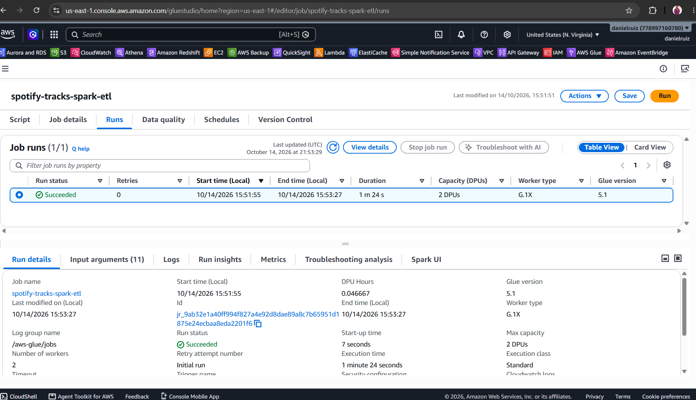
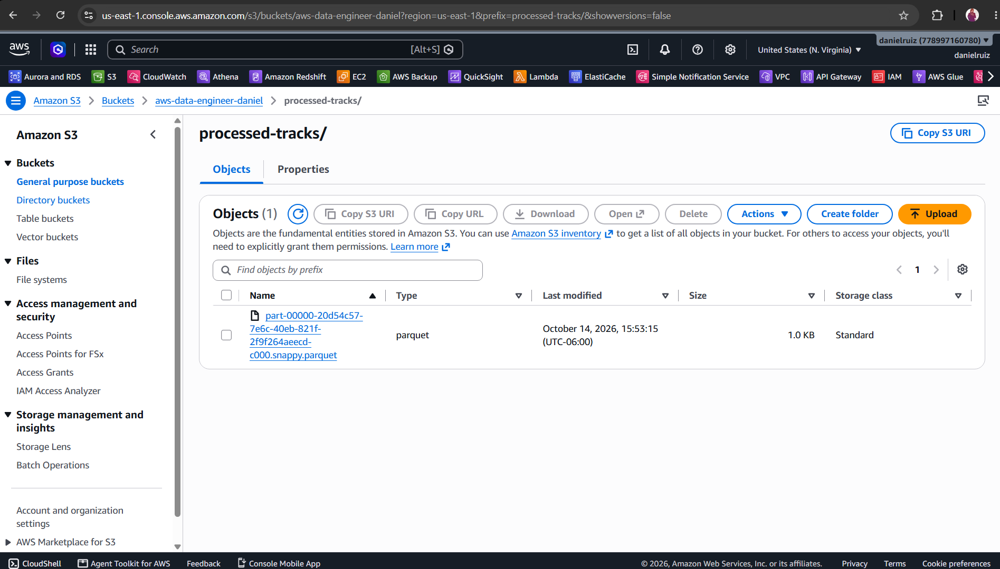
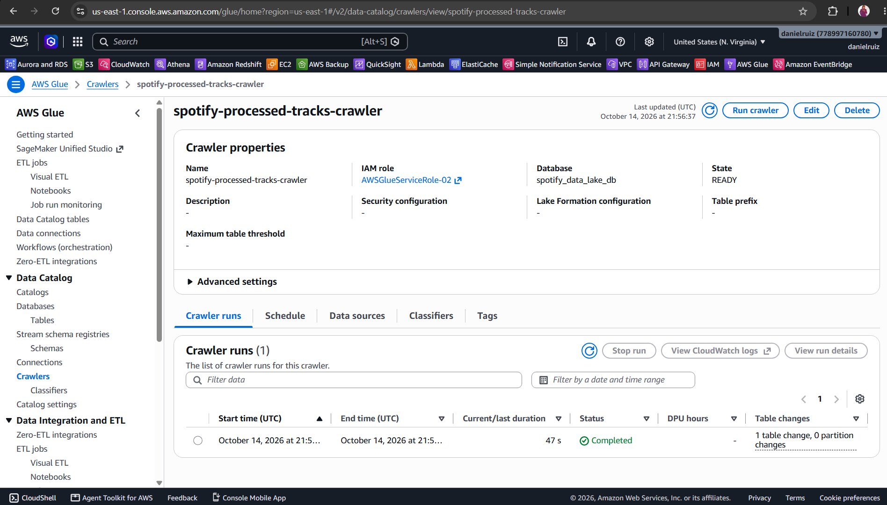
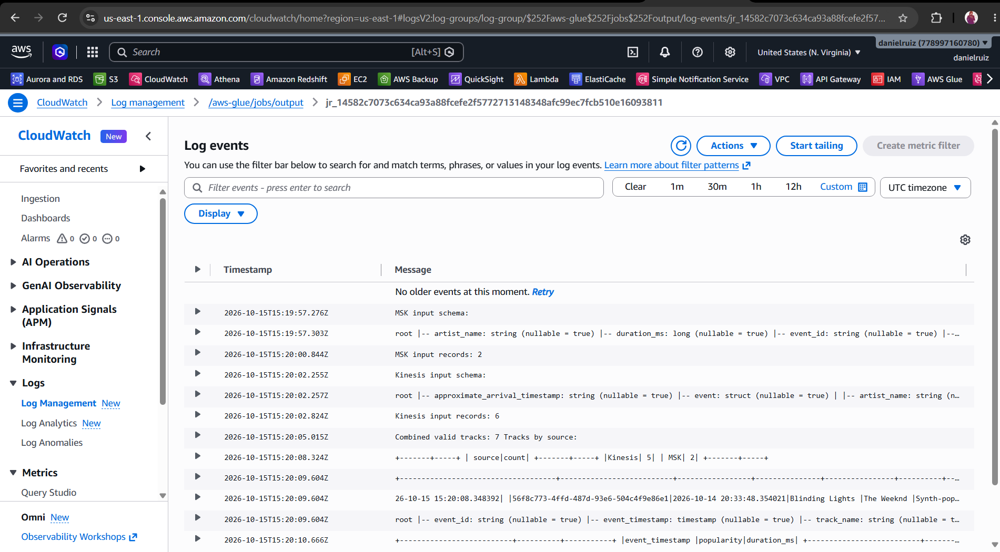

# Spotify Data Engineering Pipeline on AWS

## Project Overview

This project implements an end-to-end data engineering pipeline using AWS services to ingest, store, transform, and analyze Spotify-style track data.

The pipeline integrates Amazon Kinesis Data Streams, Amazon MSK, Amazon S3, AWS Glue with Apache Spark, Amazon Athena, Amazon Redshift Serverless, and Amazon CloudWatch.

## Architecture

The pipeline follows this data flow:

1. **Amazon Kinesis Data Streams:** Ingests streaming track events.
2. **Amazon MSK:** Produces and consumes track events using Apache Kafka.
3. **Amazon S3:** Stores raw JSON events from both streaming sources.
4. **AWS Glue with Apache Spark:** Processes and combines the data, removes duplicates, and generates Parquet files.
5. **Amazon Athena:** Queries the data stored in S3 using SQL.
6. **Amazon Redshift Serverless:** Loads the processed Parquet data for analytical queries.
7. **Amazon CloudWatch:** Monitors Glue job execution through logs and metrics.

### Architecture Diagram



*End-to-end AWS data pipeline integrating streaming ingestion, ETL processing, data lake storage, and analytics.*

## AWS Services and Technologies

## Technologies and Tools


- **Amazon Kinesis Data Streams** — Streaming data ingestion.
- **Amazon MSK** — Managed Apache Kafka.
- **Amazon S3** — Data lake storage.
- **AWS Glue** — Data catalog and ETL jobs.
- **Apache Spark / PySpark** — Distributed data processing.
- **Amazon Athena** — Serverless SQL queries.
- **Amazon Redshift Serverless** — Data warehousing and analytics.
- **Amazon CloudWatch** — Logs and monitoring.
- **AWS IAM** — Access management and permissions.
- **Python and SQL** — Data processing and analytics.
- **Parquet and Snappy** — Optimized analytical storage formats.
- **Git and GitHub** — Version control and project documentation.

## S3 Data Lake Structure

The project uses Amazon S3 as a data lake to store raw streaming events and transformed analytical data.

- **`raw-kinesis/`** — Stores JSON events exported from Amazon Kinesis Data Streams.
- **`raw-msk/`** — Stores JSON events consumed from Amazon MSK.
- **`processed-tracks/`** — Stores transformed Parquet files generated by AWS Glue and Apache Spark.

The raw data is preserved separately from the processed output, allowing the ETL pipeline to transform the data without modifying the original source files.

## ETL Processing

The AWS Glue ETL job uses Apache Spark to process the streaming data stored in Amazon S3.

The job performs the following steps:

1. Reads JSON files from the `raw-kinesis/` and `raw-msk/` prefixes.
2. Extracts track information from the nested Kinesis event structure.
3. Normalizes both sources into a common schema.
4. Combines the records into a single dataset.
5. Filters out records without a track name or artist.
6. Removes duplicate events based on `event_id`.
7. Adds a `processed_at` timestamp.
8. Writes the processed dataset to `processed-tracks/` in Parquet format with Snappy compression.

The processed dataset can then be queried using Amazon Athena and loaded into Amazon Redshift Serverless.

## Data Analysis with Amazon Athena and Redshift

#### Amazon Redshift Serverless

**Creating the tracks table**



**Loading Parquet data from Amazon S3**



**Track query results**



**Popularity analysis by source**




### Amazon Athena

Amazon Athena was used to query the processed Parquet dataset stored in Amazon S3.

The queries validated the processed records and analyzed track popularity by source.

Example query:

```sql
SELECT source, COUNT(*) AS total_tracks
FROM spotify_data_lake_db.processed_tracks
GROUP BY source
ORDER BY total_tracks DESC;
```

The validation returned 5 tracks from Kinesis and 2 tracks from MSK, for a total of 7 processed tracks.

### Amazon Redshift Serverless

Amazon Redshift Serverless was used as the data warehouse for analytical SQL queries.

The processed Parquet data was loaded into the `spotify.tracks` table from Amazon S3 using the COPY command.

Example analytical query:

```sql
SELECT
    source,
    COUNT(*) AS total_tracks,
    ROUND(AVG(popularity), 2) AS avg_popularity
FROM spotify.tracks
GROUP BY source
ORDER BY total_tracks DESC;
```

The query returned the following results:

| Source | Total Tracks | Average Popularity |
|---|---:|---:|
| Kinesis | 5 | 86.00 |
| MSK | 2 | 90.00 |

These results demonstrate how streaming data from different sources can be consolidated and analyzed using SQL.

## Monitoring and Validation

Amazon CloudWatch was used to review AWS Glue job execution logs and validate the ETL process.

The logs confirmed that the job processed data from both streaming sources, combined the records, filtered invalid entries, and generated the processed dataset.

The pipeline was validated through the following checks:

- AWS Glue ETL job completed successfully.
- Data from Kinesis and MSK was combined into a unified dataset.
- Invalid records were filtered out.
- Duplicate events were removed using `event_id`.
- Seven valid tracks were available in the processed dataset.
- Amazon Athena queries returned the expected results.
- Amazon Redshift successfully loaded the processed data and executed analytical SQL queries.

These validation steps helped confirm that the pipeline worked from data ingestion through analytical querying.

## Project Structure

```text
spotify-data-pipeline-11/
├── README.md
├── .gitignore
├── scripts/
│   └── spotify-tracks-spark-etl.py
├── sql/
│   ├── athena-queries.sql
│   └── redshift-queries.sql
└── screenshots/
    ├── 01-...
    ├── 02-...
    └── ...
```

- **`README.md`** — Project overview, architecture, technologies, and results.
- **`scripts/`** — Python and PySpark ETL scripts.
- **`sql/athena-queries.sql`** — SQL queries used to validate and analyze data in Amazon Athena.
- **`sql/redshift-queries.sql`** — SQL queries used to analyze data in Amazon Redshift Serverless.
- **`screenshots/`** — Screenshots documenting the AWS configuration, ETL execution, and query results.
- **`.gitignore`** — Specifies files that should not be tracked by Git.

## Screenshots

The screenshots/ directory contains visual evidence of the project implementation, including:

- Amazon Kinesis Data Streams configuration and event ingestion.
- Amazon MSK cluster configuration and Kafka producer/consumer tests.
- Amazon S3 raw data storage and processed Parquet output.
- AWS Glue ETL job execution and Apache Spark processing logs.
- Amazon Athena SQL queries and results.
- Amazon Redshift Serverless configuration, data loading, and analytical queries.
- Amazon CloudWatch logs used to validate the ETL execution.

These screenshots document the main implementation steps and demonstrate the successful processing and analysis of the dataset.

## Project Screenshots

### Architecture


### Streaming Data Ingestion

Screenshots of Amazon Kinesis Data Streams and Amazon MSK configuration and event ingestion.

### ETL Processing with AWS Glue and Apache Spark

Screenshots of the Glue ETL job execution, Spark processing logs, and Parquet output in Amazon S3.

#### AWS Glue and Apache Spark

**Kinesis crawler completed successfully**



**Spark ETL job execution**



**Processed Parquet output in Amazon S3**



**Processed tracks crawler**



#### Amazon CloudWatch

**Glue and Spark ETL execution logs**



CloudWatch logs were used to inspect the ETL execution and validate the processing results. The metrics screenshot is also available in the repository for reference.

### Data Analysis with Athena and Redshift

Screenshots of SQL queries and results from Amazon Athena and Amazon Redshift Serverless.

### Monitoring with CloudWatch

Screenshots of AWS Glue execution logs in Amazon CloudWatch.


## Key Learnings

Through this project, I gained practical experience with the following technologies and concepts:

- **Streaming data ingestion:** Working with Amazon Kinesis Data Streams and Amazon MSK to handle events from different sources.
- **Kafka fundamentals:** Creating producers and consumers and exchanging messages through Apache Kafka.
- **Data lake architecture:** Organizing raw JSON data and processed Parquet files in Amazon S3.
- **ETL development:** Building an AWS Glue job with PySpark to normalize, combine, filter, and deduplicate records.
- **Data quality:** Validating schemas, converting data types, filtering incomplete records, and removing duplicate events.
- **Data formats and compression:** Using Apache Parquet with Snappy compression for analytical workloads.
- **Serverless analytics:** Querying processed data with Amazon Athena.
- **Data warehousing:** Loading data into Amazon Redshift Serverless and analyzing it with SQL.
- **Monitoring and troubleshooting:** Reviewing AWS Glue execution logs in Amazon CloudWatch and resolving configuration and permissions issues.
- **Data engineering workflow:** Documenting the architecture, maintaining Python and SQL scripts, and organizing project evidence in GitHub.

## Conclusion

This project demonstrates an end-to-end data engineering pipeline built with AWS services and open-source technologies.

By integrating Amazon Kinesis Data Streams and Amazon MSK, the pipeline brings together streaming events from multiple sources. AWS Glue and Apache Spark transform the raw JSON data into a unified Parquet dataset stored in Amazon S3. Amazon Athena and Amazon Redshift Serverless then enable SQL-based analysis of the processed tracks.

The final dataset contained seven valid track records: five from Kinesis and two from MSK. Successful ETL execution, Athena queries, and Redshift data loading validated the main pipeline workflow.

This project strengthened my practical knowledge of AWS data engineering, streaming ingestion, ETL development, data quality, analytical SQL, monitoring, and technical documentation.

It also represents a step forward in my continued learning and development as an AWS Data Engineer.

## Contact

**Daniel Ruiz López**  
*AWS Data Engineer*

- **Email:** [danielruizlopez889@gmail.com](mailto:danielruizlopez889@gmail.com)
- **WhatsApp:** [+52 229 172 8291](https://wa.me/522291728291)
- **LinkedIn:** [danielruizl](https://www.linkedin.com/in/danielruizl)
- **GitHub:** [danielruiz501](https://github.com/danielruiz501)